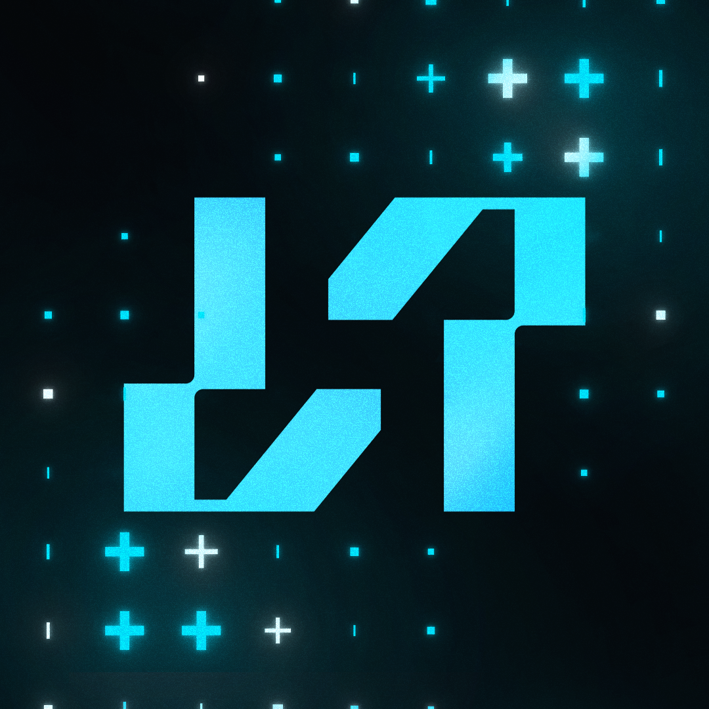

<h1 align='center'>NPKStudios ESX + Overextended Recipe</h1>

<b><a href='https://discord.esx-framework.org/'>ESX Discord</a> - <a href='https://www.esx-framework.org/'>ESX Website</a> - <a href='https://docs.esx-framework.org/en'>ESX Documentation</a></b>

<b><a href='https://overextended.dev/'>Overextended Docs</a> - <a href='https://discord.overextended.dev/'>OX Discord</a></b>

<b><a href='https://npkstudios.pl'>NPKStudios Website & Store</a> - <a href='https://discord.gg/npkstudios'>NPKStudios Discord</a></b>

**This is a custom recipe combining ESX Legacy with Overextended resources, created by NPKStudios.**

## What's Included

### ESX Framework
ESX is the industry leading framework for creating servers on FiveM, with many official and community resources designed to utilise the tools provided here.

For a taste of what's available:
- esx_identity: Enables character registration defining a players name, sex, height, and date of birth
- esx_society: Allows job resources to register a society, gaining employee management, society funds, and more
- esx_billing: Allows members of some societies to send fines or bills to other players
- esx_vehicleshop: Allow players to purchase vehicles from a dealership, or setup society support for a player-managed dealership
- esx_ambulancejob: Adds a death and respawn system while allowing players to work as EMS to heal and revive others

### Overextended Resources
This recipe includes the following Overextended resources (always downloaded from the latest GitHub release):
- **ox_lib**: Core library providing UI components, callbacks, and utilities
- **oxmysql**: High-performance MySQL wrapper with advanced features
- **ox_inventory**: Modern slot-based inventory system with metadata support
- **ox_target**: Third-eye targeting system for enhanced player interaction
- **ox_fuel**: Vehicle fuel system
- **ox_doorlock**: Advanced door locking system

All Overextended resources are pre-configured in `overextended.cfg` with optimal settings.

`esx_inventory` is removed during install, ox_inventory is used instead (ESX switches to it automatically).

Game build: `3889` (mp2026_01 - The Kortz Center Heist), currently the latest FiveM build.

## Server Listing (Cfx Portal)
Since **21 October 2026** the FiveM server list no longer reads its details from `server.cfg`. `sv_hostname`, `sv_projectName`, `sv_projectDesc`, `tags`, `locale`, `load_server_icon` and `banner_detail` are deprecated.

After installing, open the [Cfx Portal](https://portal.cfx.re/), select the server attached to your license key and fill in:
- **Name / Tagline**
- **Description**
- **Tags** (max 5)
- **Language**
- **Icon / Banner**: you can use `NPKStudios_logo.png` from this repository
- **Discord link**: in the Social section

If you leave these empty, the server list shows *"Missing server data (must be configured in Portal)"*.

Many more resources are included in this Recipe, or you can browse the [Cfx.re Releases board](https://forum.cfx.re/tag/esx) for more.

---

**Maintained by [NPKStudios](https://npkstudios.pl)** - [Discord](https://discord.gg/npkstudios)
